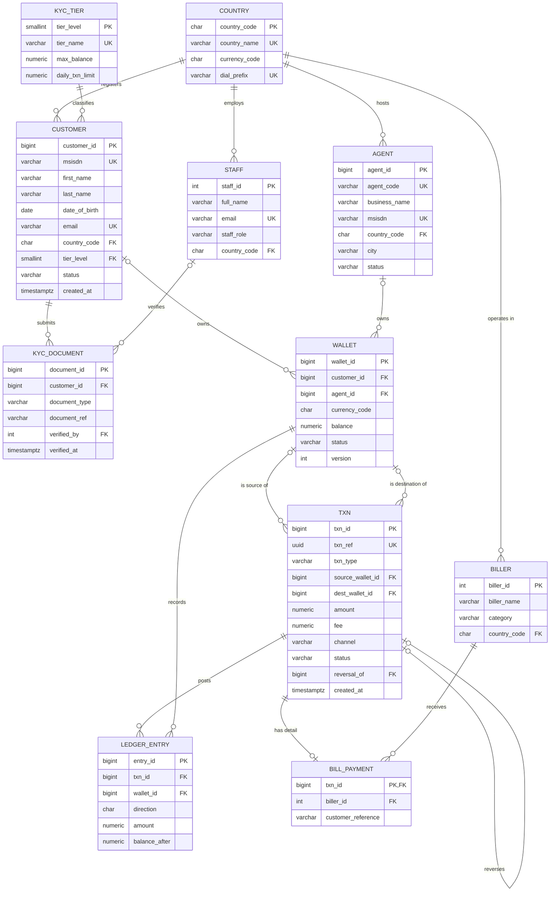

# Portfolio 1: Database Design and Modelling

## 1. Case study: KashLink Mobile Money (simulated)

| Item | Description |
|---|---|
| **Organisation** | KashLink Mobile Money Ltd, a **fictional** mobile money operator running in Nigeria, Ghana and Uganda. All names, phone numbers and data are made up. |
| **Nature of business** | Customers hold an e-money wallet tied to their phone number (MSISDN). They deposit and withdraw cash through a network of agents, send money to other users, and pay bills (airtime, electricity, TV). Access channels are USSD, mobile app, agent kiosk and partner API. |
| **Database users** | Customers (via the apps), agents, KYC officers (verify identity documents), finance/reconciliation staff, customer-support staff, and partner systems calling the API. |
| **Major data stored** | Countries and currencies, KYC tiers and limits, customers, KYC documents, agents, wallets, transactions, double-entry ledger entries, billers and bill-payment details, staff. |
| **Key operations** | Register customer and upgrade KYC tier; cash-in/cash-out at an agent; P2P transfer; bill payment; reverse a mistaken transfer; generate a wallet statement; reconcile wallet balances against the ledger; report agent and channel performance. |

**Why this case study:** money movement needs strict integrity (Portfolio 1) and atomic transfers under concurrency (Portfolio 3). The high transaction volume suits query optimisation (Portfolio 2). Flexible KYC and device data suits a document store (Portfolio 4). Operating across several countries raises real sharding and data-residency questions (Portfolio 5).

## 2. Entity-Relationship diagram



*(GitHub renders this diagram automatically. An image copy is in `er-diagram.png`.)*

### Notable modelling decisions

- **Exclusive arc on WALLET.** A wallet belongs to either a customer or an agent, never both and never neither. This is enforced by `CHECK (num_nonnulls(customer_id, agent_id) = 1)`. It avoids two near-identical wallet tables and lets every transfer use one consistent `source_wallet → dest_wallet` shape.
- **Transaction vs ledger.** `txn` records the business event (who, what, which channel, status). `ledger_entry` records the accounting effect (one debit and one credit). This is standard double-entry bookkeeping: the sum of all debits always equals the sum of all credits, which makes auditing possible.
- **Recursive relationship.** `txn.reversal_of` points to the original transaction, so every reversal can be traced back to it.
- **Subtype table.** `bill_payment` holds the fields that only bill payments need (biller, meter or smartcard number). This keeps nullable columns out of `txn`.
- **`txn` instead of `transaction`.** `TRANSACTION` is an SQL reserved word.

## 3. Relational schema

```
COUNTRY      (country_code, country_name, currency_code, dial_prefix)
KYC_TIER     (tier_level, tier_name, max_balance, daily_txn_limit)
STAFF        (staff_id, full_name, email, staff_role, country_code→COUNTRY)
BILLER       (biller_id, biller_name, category, country_code→COUNTRY, is_active)
CUSTOMER     (customer_id, msisdn, first_name, last_name, date_of_birth, email,
              country_code→COUNTRY, tier_level→KYC_TIER, status, created_at)
KYC_DOCUMENT (document_id, customer_id→CUSTOMER, document_type, document_ref,
              submitted_at, verified_by→STAFF, verified_at)
AGENT        (agent_id, agent_code, business_name, msisdn, country_code→COUNTRY, city, status, onboarded_at)
WALLET       (wallet_id, customer_id→CUSTOMER, agent_id→AGENT, currency_code, balance, status, version, opened_at)
TXN          (txn_id, txn_ref, txn_type, source_wallet_id→WALLET, dest_wallet_id→WALLET, amount, fee,
              currency_code, channel, status, reversal_of→TXN, failure_reason, created_at, completed_at)
LEDGER_ENTRY (entry_id, txn_id→TXN, wallet_id→WALLET, direction, amount, balance_after, posted_at)
BILL_PAYMENT (txn_id→TXN, biller_id→BILLER, customer_reference)
```
Primary keys are listed first in each relation. `→` marks a foreign key.

## 4. Keys and constraints

| Type | Examples | Purpose |
|---|---|---|
| Primary keys (surrogate) | `customer_id`, `wallet_id`, `txn_id` (BIGSERIAL) | Stable, compact identifiers that survive phone-number changes |
| Primary keys (natural) | `country.country_code`, `kyc_tier.tier_level` | Codes that are already standard and stable |
| Candidate keys (UNIQUE) | `customer.msisdn`, `agent.agent_code`, `txn.txn_ref`, `(document_type, document_ref)` | Business identifiers that must not repeat |
| Foreign keys | 16 FKs, e.g. `wallet.customer_id → customer` | Referential integrity |
| Domain CHECKs | `amount > 0`, `balance >= 0`, MSISDN regex, status enumerations | Reject invalid values |
| Business-rule CHECKs | single wallet owner; customer aged 18+; a reversal must reference its original; a FAILED txn needs a reason; KYC verifier and date are set together | Encode rules in the database, not only in application code |
| Idempotency key | `txn.txn_ref UUID UNIQUE` | A retried API call cannot post the same transfer twice |

## 5. Normalisation

See [`normalisation.md`](normalisation.md). It walks from a flat agent spreadsheet (UNF) through 1NF, 2NF and 3NF and checks BCNF. It also justifies the two deliberately redundant columns (`wallet.balance`, `ledger_entry.balance_after`).

## 6. How to run and test

```bash
createdb kashlink
psql -d kashlink -f 01_schema.sql            # create schema
psql -d kashlink -f 02_seed.sql              # load sample data
psql -d kashlink -f 03_constraint_tests.sql  # 17 negative tests + integrity checks
```

**Expected results:**
- All 17 tests print `PASS`. Each one deliberately tries invalid data, and PASS means the database rejected it.
- V2 (ledger reconciliation) returns 0 rows.
- V3 shows 13 wallets. For example, Chioma Okeke holds NGN 39,000.00 and agent Mama Tee Ventures holds NGN 1,630,000.00.

## 7. Evidence

Screenshots are stored in [`evidence/`](evidence/):

- `p1_schema_tables.png`: `\dt kashlink.*` listing the 11 tables
- `p1_constraint_tests.png`: output of the 17 constraint tests
- `p1_reconciliation.png`: V2 and V3 output
- `er-diagram.png`: rendered ER diagram

## 8. Assumptions

- Each country has one currency. Tier limits are in local-currency units.
- Fees are recorded on `txn` but fee revenue posting is out of scope for this portfolio.
- Agent float funding from a bank is modelled as a `CASH_IN` with no source wallet (money entering the system from outside).
