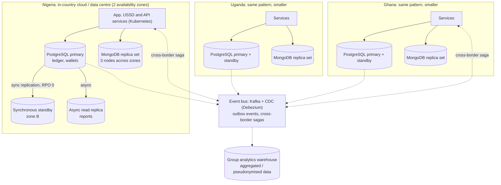

# Portfolio 5: Distributed and Cloud Database Exercise

**Case study:** KashLink Mobile Money (simulated), operating in Nigeria, Ghana and Uganda
**Tools:** MongoDB 7 replica set (Docker, 3 nodes) · PostgreSQL 16 declarative partitioning · Docker Compose

## 1. Distribution requirements

| Requirement | Why it matters for KashLink |
|---|---|
| **Availability** | Customers pay for transport, food and bills through KashLink. If the database is down, customers cannot pay and agents cannot serve cash. One server is a single point of failure. |
| **Consistency for money** | A confirmed transfer must never disappear after a server failure, and no two servers may both accept conflicting writes (split brain). |
| **Data residency** | Central-bank and data-protection rules in all three markets favour or require keeping customer and payment data in-country (for example, Nigeria's Data Protection Act 2023). Data cannot simply sit in one foreign region. |
| **Scale and locality** | Nigeria generates ~70% of traffic. Each country's users should be served from nearby infrastructure. |

The work demonstrates **replication, availability and consistency** hands-on (Part A), **sharding** by country (Part B), and a **cloud deployment design** that combines them (Part C).

## 2. Part A: MongoDB replica set (replication, failover, consistency)

**Setup:** [`docker-compose.replicaset.yml`](docker-compose.replicaset.yml) starts three `mongod` nodes (`mongo1`–`mongo3`) in replica set `klrs`, plus a client container. [`01_replicaset_demo.sh`](01_replicaset_demo.sh) runs every step and asks **each node directly** what role it has and what data it holds ([`replicaset/status.js`](replicaset/status.js)).

| Step | Action | Observed result | Concept shown |
|---|---|---|---|
| 1–2 | Start 3 nodes, `rs.initiate()` | One node is elected **PRIMARY**, the other two are **SECONDARY** | Replica set, leader election |
| 3 | Insert wallets with `writeConcern: {w: "majority"}`, then run two **multi-document transactions** | The write is acknowledged only after 2 of 3 nodes have it. Transfer 1 **commits** (debit + credit + record together). Transfer 2 **aborts** on insufficient funds and saves nothing. **All 3 nodes hold identical data** | **Replication**, ACID across documents (the Portfolio 4 limitation, now solved with a replica set) |
| 4 | `docker stop` the **primary** | The two survivors elect a **new primary in about 1 s** (mongo1 → mongo2 in my run). A majority write then succeeds; the client reconnects on its own | **Availability**: automatic failover with no manual action |
| 5 | Stop a **second** node (1 of 3 left) | **Majority write FAILS** (no primary can be elected without a majority; in Docker the error reads `MongoServerSelectionError … ENOTFOUND`, because stopped containers drop out of Docker's DNS, so no primary is reachable). **Read still succeeds** from the surviving secondary (data possibly stale) | **CAP**: during a partition MongoDB chooses **consistency** for writes (no split brain); reads remain **available** |
| 6 | Restart both nodes | They rejoin as members, **catch up from the oplog**, and the write made during failover appears on all 3 nodes | Self-healing, eventual convergence |

**What this proves for KashLink**
- **Majority quorum prevents split brain.** Two nodes can never both be primary, because a primary needs votes from a majority (2 of 3). In Step 5 the lone node refused writes rather than risk accepting a conflicting history. For money, refusing a write is far safer than accepting one that may later be rolled back.
- **`w: "majority"` gives RPO = 0 for acknowledged writes.** A write confirmed to the customer is already on at least two nodes, so losing any single node loses no confirmed data. `w: 1` would be faster but could lose writes on failover.
- **Reads can trade freshness for availability.** `readPreference: secondaryPreferred` kept statements readable with only one node alive. Balance checks before a debit must instead read from the primary with `readConcern: "majority"`.

## 3. Part B: Sharding by country (PostgreSQL partitioning)

Script: [`02_partitioning.sql`](02_partitioning.sql) · Output: [`results/02_partitioning.txt`](results/02_partitioning.txt)

`txn_by_country` is **LIST-partitioned on `country_code`**, the proposed **shard key**. On one server these are partitions. In production each would be a shard on in-country infrastructure (for example Citus, or postgres_fdw with one server per country).

| Test | Result |
|---|---|
| Load 551k transactions | Rows were **routed automatically**: `txn_ng` 70%, `txn_gh` 20%, `txn_ug` 10% |
| Ghana report **with** the shard key | Plan touches **only `txn_gh`** (partition pruning). The other countries' data is never read |
| Report **without** the shard key | `Append` over **all three partitions** (scatter-gather). It works, but every shard does work |
| Insert a row for Kenya (`KE`) | **Rejected**: `no partition of relation found for row` |
| Add `txn_ke`, insert again | Accepted. Entering a new market is **one new partition**, and existing data is not moved |

**Why `country_code` is the right shard key**
1. **Residency by design.** Each country's data lives entirely on its own shard, which can be hosted in that country.
2. **Most queries are single-country.** Wallets, agents, billers and currencies are national, so almost every transaction and report includes the country and is routed to one shard.
3. **Fault isolation.** A problem in the Ghana shard does not affect Nigeria.

**Trade-offs and mitigations**

| Risk | Mitigation |
|---|---|
| **Hot shard**: Nigeria holds 70% of the load | Sub-shard Nigeria by a hash of `wallet_id` when needed (country + hash = compound shard key) |
| **Cross-country reports** become scatter-gather | Feed group-level analytics from change-data-capture into a separate warehouse, not by querying live shards |
| **Cross-border transfers** (e.g. NG → GH) span two shards | Use a **saga**: debit in NG, then credit in GH, with a compensating reversal on failure. Each step uses the Portfolio 3 idempotency key, which avoids a slow cross-country two-phase commit |
| Small **reference tables** (`kyc_tier`, `country`) are needed everywhere | Replicate them to every shard as "reference tables" |

## 4. Part C: Target cloud deployment architecture



*(GitHub renders this diagram automatically. An image copy is in [`architecture.png`](architecture.png) for the LMS document.)*

**Design decisions**

| Layer | Choice | Reason |
|---|---|---|
| Ledger (PostgreSQL) | Primary + **synchronous** standby in a second zone, automatic failover (e.g. Patroni or a Kubernetes operator such as CloudNativePG). An async replica serves reports | Money needs RPO 0. Synchronous commit to a nearby zone adds only a few milliseconds |
| Profiles / KYC / events (MongoDB) | 3-node replica set across zones, `w: "majority"`, as proven in Part A | Automatic failover in seconds. Majority writes keep confirmed data safe |
| Placement | **Country-level shards** in in-country cloud regions or local data centres | Data residency. Low latency for local users |
| Integration | **Outbox + CDC** to Kafka, then to analytics and the other countries | Loose coupling. No cross-country synchronous dependency |
| Backups | Continuous WAL archiving (PostgreSQL point-in-time recovery) and daily snapshots, copied to a second in-country site | Recovery from human error or ransomware, which replication alone cannot fix (a bad `DELETE` replicates too) |

**Consistency model by data type (CAP / PACELC)**

| Data | During a failure (CAP) | Normal operation (PACELC: latency vs consistency) | Setting |
|---|---|---|---|
| Wallet balance, ledger | **Consistency**: refuse rather than risk double-spend | Consistency | Sync standby; `readConcern/writeConcern: majority` |
| Customer profile, KYC | Consistency for writes, availability for reads | Latency (read nearest) | `w: majority`, `secondaryPreferred` reads |
| Statements, analytics | **Availability** | Latency: seconds of lag acceptable | Async replicas, CDC, eventual consistency |

**Recovery objectives**

| Scenario | RPO (data loss) | RTO (downtime) |
|---|---|---|
| One database node or zone fails | **0** (sync standby / majority writes) | **Seconds**: automatic election (Part A, Step 4) |
| Whole primary data centre lost | Seconds (async copy to second site) | Minutes, via a scripted promotion of the DR site |
| Logical corruption (bad deploy, accidental delete) | To the minute before the error (point-in-time recovery) | Hours, restoring from backup and WAL replay |

## 5. How to run

From the repository root:

```bash
# Part A: replica set (about 2-3 minutes). Uses its own containers, separate from the main setup
bash portfolio-5-distributed-cloud/01_replicaset_demo.sh | tee portfolio-5-distributed-cloud/results/01_replicaset_demo.txt
docker compose -f portfolio-5-distributed-cloud/docker-compose.replicaset.yml down     # remove the cluster afterwards

# Part B: partitioning (uses the PostgreSQL data from Portfolios 1-2)
docker exec kashlink-postgres psql -U postgres -d kashlink -f /portfolio/portfolio-5-distributed-cloud/02_partitioning.sql > portfolio-5-distributed-cloud/results/02_partitioning.txt 2>&1
```

## 6. Files

| File | Purpose |
|---|---|
| `docker-compose.replicaset.yml` | 3-node MongoDB replica set + client container |
| `01_replicaset_demo.sh` | Part A: automated replication / transaction / failover / quorum / recovery demo |
| `replicaset/*.js` | mongosh scripts used by the demo (init, status per node, transactions, write test) |
| `02_partitioning.sql` | Part B: LIST partitioning by country, pruning, routing, adding a market |
| `results/`, `evidence/` | Captured output and screenshots |
